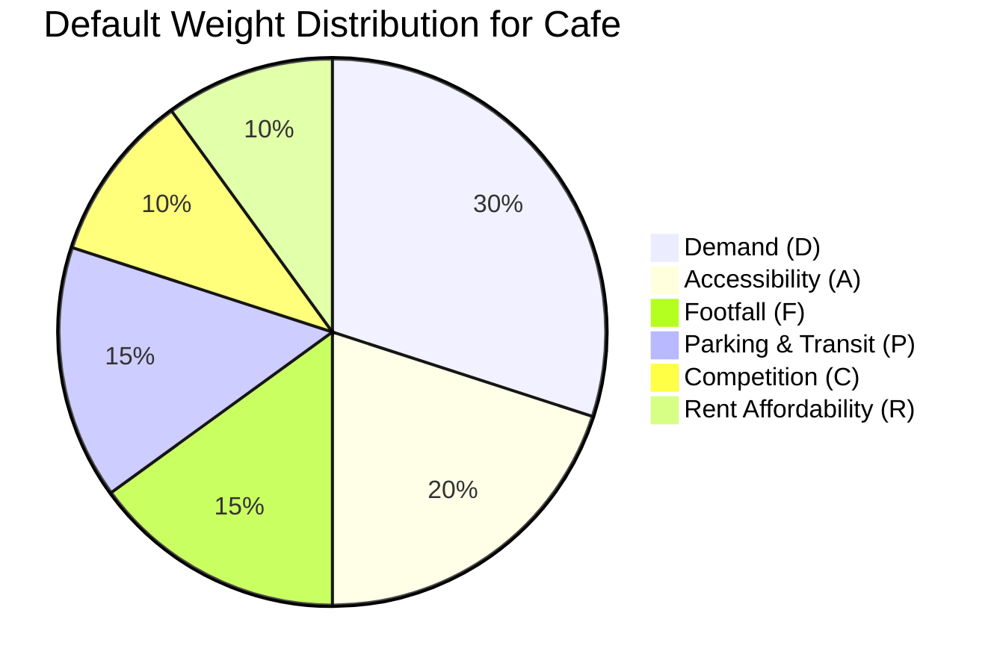

# Mathematical Methodology, Scoring Engine & ML Pipeline
## AI-Based Business Location Selector Using Machine Learning

---

## 1. End-to-End 10-Step Methodology

The project adheres to a disciplined 10-step engineering workflow:

```text
[Step 1: Define Scope] ──► [Step 2: Ingest Data] ──► [Step 3: Data Cleaning] ──► [Step 4: Exploratory Analysis]
                                                                                            │
[Step 8: K-Means Clustering] ◄── [Step 7: Train & Compare ML] ◄── [Step 6: Data Split] ◄── [Step 5: Feature Engineering]
         │
         ▼
[Step 9: Multi-Criteria Ranking] ──► [Step 10: Interactive Dashboard & Decision Review]
```

1. **Step 1 — Define Scope:** Establish the operational profile for four primary retail categories: **Café**, **Pharmacy**, **Grocery Store**, and **Clothing Shop** across the municipal territory of **Bhopal**.
2. **Step 2 — Collect & Ingest Data:** Aggregate demographic catchment population, estimated commercial rents, competitor counts, footfall, transit access scores, and proximity to anchor institutions (hospitals, colleges, offices, markets).
3. **Step 3 — Clean the Data:** Check for null values, remove synthetic duplicates, assert boundary constraints (e.g., scores bounded within $[1, 10]$, positive rent and population values).
4. **Step 4 — Perform EDA:** Analyze univariate distributions, box plots for rent across localities, scatter relationships between footfall and observed demand, and multi-collinearity matrices.
5. **Step 5 — Engineer Features:** Compute relative rent affordability indices, combine transit and parking into a unified mobility index, compute competitor saturation ratios, and apply Min-Max / Standard scaling.
6. **Step 6 — Split the Data:** Perform stratified train/test partitions ($80\%$ train, $20\%$ test) preventing data leakage.
7. **Step 7 — Train & Compare ML Models:** Train and benchmark Linear Regression, Decision Tree, and Random Forest Regressors using 5-fold cross-validation.
8. **Step 8 — Cluster Candidate Locations:** Implement K-Means clustering, optimize cluster count $k$ using the Elbow curve and Silhouette score, and assign semantic archetypes.
9. **Step 9 — Multi-Criteria Ranking:** Compute the weighted suitability index $S$ for every candidate based on user-defined strategic weights.
10. **Step 10 — Deploy Interactive Dashboard:** Provide real-time sliders, geospatial map visualizers, radar comparison charts, and CSV report exports.

---

## 2. Multi-Criteria Suitability Scoring Formula

### The Master Formulation
To evaluate the viability of a candidate location without producing an ungrounded black-box score, the system employs a transparent Multi-Criteria Decision Analysis (MCDA) model:

$$S = w_D \cdot D + w_A \cdot A + w_F \cdot F + w_P \cdot P + w_C \cdot C + w_R \cdot R$$

Where:
- $S \in [0, 100]$: Composite Location Suitability Score.
- $w_D, w_A, w_F, w_P, w_C, w_R$: User-configurable priority weights, subject to the normalization constraint:
  $$\sum w_i = w_D + w_A + w_F + w_P + w_C + w_R = 1.00$$

### Sub-Score Definitions & Normalization ($[0, 100]$)

| Factor | Notation | Description | Mathematical Calculation |
| :--- | :---: | :--- | :--- |
| **Customer Demand** | $D$ | Projected commercial demand derived from the trained Random Forest model or baseline index. | Normalized Min-Max scale of target demand: $$D = \frac{\hat{y} - y_{min}}{y_{max} - y_{min}} \times 100$$ |
| **Accessibility** | $A$ | Ease of road connectivity, pedestrian sidewalk quality, and reachability. | Rescaled from 1–10 input score: $$A = \frac{\text{accessibility\_score} - 1}{9} \times 100$$ |
| **Footfall Traffic** | $F$ | Daily pedestrian and visitor volume passing the storefront. | Normalized daily pedestrian count: $$F = \frac{\text{footfall} - F_{min}}{F_{max} - F_{min}} \times 100$$ |
| **Parking & Public Transit** | $P$ | Multi-modal commuter accessibility combining parking convenience and transit proximity. | Average of rescaled parking and public transit scores: $$P = \frac{(\text{parking} + \text{transit}) - 2}{18} \times 100$$ |
| **Competition Opportunity** | $C$ | Balance between market saturation and proven category demand. | Non-linear opportunity curve penalizing oversaturation while recognizing cluster benefits: $$C = 100 \times \max\left(0, 1 - \frac{\text{competitor\_count}}{C_{max}}\right)$$ |
| **Rent Affordability** | $R$ | Commercial rent viability relative to the entrepreneur's stated monthly budget ($B$). | Piecewise linear affordability function: $$R = \begin{cases} 100 & \text{if } \text{Rent} \le 0.5 B \\ 100 - 60 \cdot \left(\frac{\text{Rent} - 0.5B}{0.5B}\right) & \text{if } 0.5 B < \text{Rent} \le B \\ \max\left(0, 40 - 80 \cdot \frac{\text{Rent} - B}{B}\right) & \text{if } \text{Rent} > B \end{cases}$$ |

---

## 3. Recommended Weight Profiles by Business Category

Different commercial operations prioritize distinct operational attributes:



| Business Category | $w_D$ (Demand) | $w_A$ (Access) | $w_F$ (Footfall) | $w_P$ (Mobility) | $w_C$ (Competition) | $w_R$ (Rent) | Strategic Rationale |
| :--- | :---: | :---: | :---: | :---: | :---: | :---: | :--- |
| **Café / Coffee Shop** | **0.30** | **0.20** | **0.15** | **0.15** | **0.10** | **0.10** | High reliance on impulse footfall, youth/office demographics, and transit hubs. |
| **Pharmacy / Chemist** | **0.25** | **0.25** | **0.10** | **0.15** | **0.10** | **0.15** | Accessibility and proximity to hospitals/clinics matter more than pedestrian footfall. |
| **Grocery / Convenience** | **0.25** | **0.15** | **0.20** | **0.15** | **0.10** | **0.15** | High dependence on neighborhood residential density and repeat everyday footfall. |
| **Clothing / Apparel Boutique**| **0.25** | **0.20** | **0.20** | **0.15** | **0.10** | **0.10** | Thrives in established commercial agglomerations and high-visibility retail streets. |

---

## 4. Machine Learning Algorithms Specification

### Model A: Linear Regression (Baseline)
- **Objective:** Establish the linear lower-bound performance.
- **Formulation:**
  $$\hat{y} = \beta_0 + \sum_{j=1}^{p} \beta_j X_j + \epsilon$$
- **Strengths:** Rapid computation, closed-form ordinary least squares solution, direct parameter interpretability via coefficients $\beta_j$.
- **Limitations:** Incapable of modeling complex non-linear feature interactions (such as the diminishing returns of footfall when rent is prohibitive).

### Model B: Decision Tree Regressor (CART)
- **Objective:** Extract hierarchical, human-interpretable threshold rules.
- **Formulation:** Recursively partitions the feature space into hyper-rectangles $R_m$ minimizing mean squared error:
  $$Q_m(T) = \frac{1}{N_m} \sum_{i \in R_m} (y_i - \hat{y}_{R_m})^2$$
- **Hyperparameter Tuning:** `max_depth` $\in [3, 10]$, `min_samples_split` $\in [5, 20]$, `min_samples_leaf` $\in [2, 10]$ to prevent tree overfitting.

### Model C: Random Forest Regressor (Ensemble Benchmark)
- **Objective:** Capture complex non-linear interactions while minimizing variance through bagging (bootstrap aggregation).
- **Formulation:**
  $$\hat{y}_{RF} = \frac{1}{B} \sum_{b=1}^{B} T_b(x)$$
  where each tree $T_b$ is trained on a bootstrap sample with randomized feature subsets (feature sub-sampling $\sqrt{p}$ or $p/3$).
- **Explainability:** Mean Decrease in Impurity (MDI) provides feature importance rankings indicating which variables drive commercial demand predictions.

### Model D: K-Means Clustering (Unsupervised Market Segmentation)
- **Objective:** Partition candidate locations into $k$ distinct archetypes without labels.
- **Formulation:** Minimizes the Within-Cluster Sum of Squares (WCSS / Inertia):
  $$J = \sum_{k=1}^{K} \sum_{x_i \in C_k} \| x_i - \mu_k \|^2$$
- **Cluster Count Optimization:**
  1. **Elbow Method:** Plot Inertia vs. $k \in [2, 8]$ and locate the point of diminishing marginal returns.
  2. **Silhouette Coefficient:** Evaluate cluster separation and cohesion:
     $$s(i) = \frac{b(i) - a(i)}{\max(a(i), b(i))}, \quad s(i) \in [-1, 1]$$
- **Semantic Archetypes:**
  - *Cluster 0: Budget Emerging Corridor* (Low Rent, Moderate Footfall, Developing Transit).
  - *Cluster 1: Prime Commercial Epicenter* (High Rent, High Footfall, High Demand, Dense Competition).
  - *Cluster 2: Saturated High-Risk Hub* (High Rent, Intense Competition, Stagnant Growth).
  - *Cluster 3: Residential Niche* (Affordable, Low Competition, Steady Localized Demand).

---

## 5. Model Evaluation Metrics

| Task | Metric | Mathematical Formula | Interpretation |
| :--- | :---: | :--- | :--- |
| **Regression** | **MAE** | $$\text{MAE} = \frac{1}{n} \sum_{i=1}^{n} |y_i - \hat{y}_i|$$ | Average absolute magnitude of demand prediction error in original units. |
| **Regression** | **RMSE** | $$\text{RMSE} = \sqrt{\frac{1}{n} \sum_{i=1}^{n} (y_i - \hat{y}_i)^2}$$ | Penalizes larger error outliers more heavily than MAE. |
| **Regression** | **$R^2$ Score** | $$R^2 = 1 - \frac{\sum (y_i - \hat{y}_i)^2}{\sum (y_i - \bar{y})^2}$$ | Proportion of variance in commercial demand explained by the feature set. |
| **Clustering** | **Silhouette**| $$S_{avg} = \frac{1}{n} \sum_{i=1}^{n} s(i)$$ | Values $> 0.40$ indicate well-separated and cohesive candidate clusters. |
